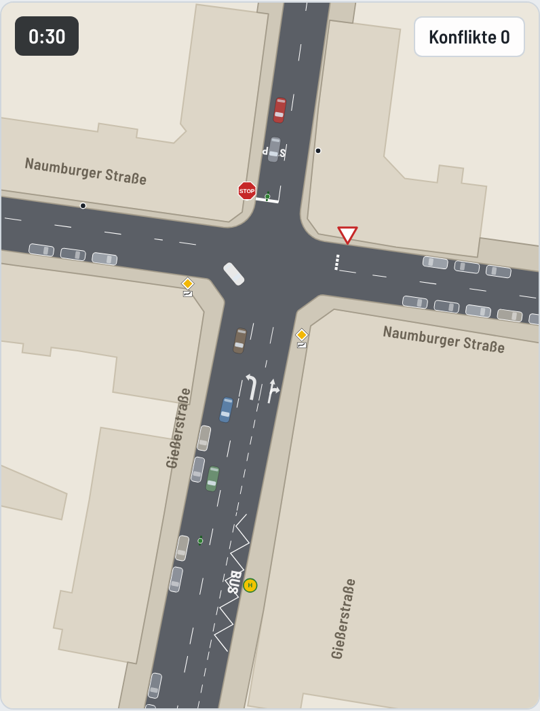
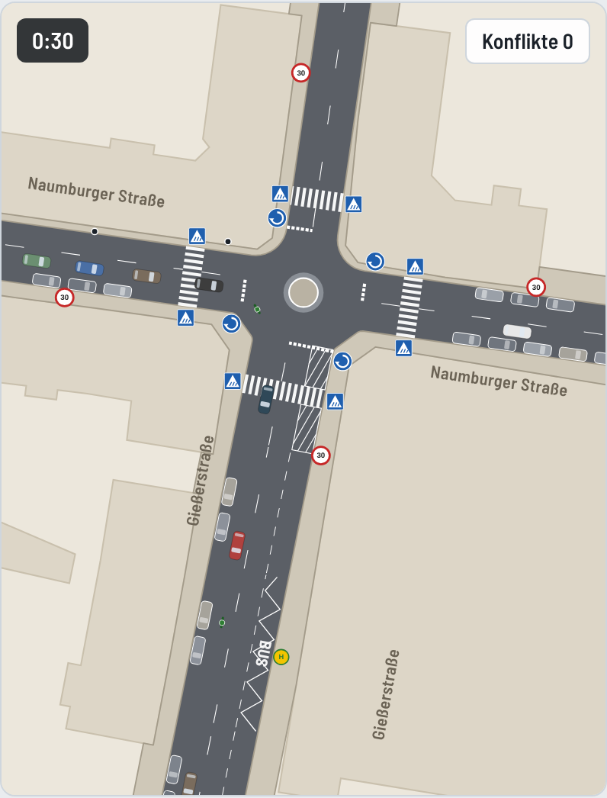
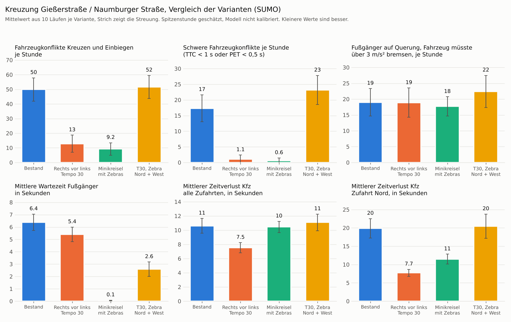

# SUMO-Modell Gießerstraße / Naumburger Straße

Mikroskopische Verkehrssimulation der Kreuzung in Leipzig-Plagwitz mit dem freien Simulator [Eclipse SUMO](https://eclipse.dev/sumo/). Das Modell vergleicht den Bestand mit drei Umbauvarianten und liefert Kennzahlen zu Sicherheit und Wartezeiten für die Bürgerkampagne. Das Browsermodell in `../modell` bleibt das Anschauungsmodell, dieses SUMO-Modell ist die nachvollziehbare Rechengrundlage.

**Abspieler im Browser** in [`grafik/abspieler.html`](grafik/abspieler.html). Die Datei herunterladen und im Browser öffnen, sie läuft ohne Internet (nur die Schrift kommt von Google Fonts). Fünf Minuten der Spitzenstunde je Variante, flüssig mit 60 Bildern je Sekunde, Beinahe-Unfälle blinken als Ringe auf.

| Bestand | Minikreisel |
|---|---|
|  |  |

## Aufruf

```bash
pip install -r requirements.txt     # SUMO, matplotlib, shapely, pillow
python3 build.py                    # Netze und Nachfrage aller Varianten
python3 run.py                      # 10 Läufe je Variante, etwa 2 Minuten
python3 plots.py                    # Vergleichsdiagramm und Netzbilder nach grafik/
python3 abspieler/export.py         # Browser-Abspieler grafik/abspieler.html
```

Weitere Schalter

- Standard ist der Regelbetrieb, die Busse fahren von Süd nach West. `python3 build.py --bus SN` bildet die derzeitige Baustellenumleitung ab (Naumburger Straße ist Sackgasse, die Busse fahren geradeaus Süd und Nord, so steht es im Oktober 2026 auch in OpenStreetMap).
- `python3 run.py --laeufe 3 --varianten bestand minikreisel` für schnelle Proben.
- `python3 run.py --nur-bericht` schreibt `vergleich.md` aus der vorhandenen CSV neu.
- `python3 werkzeuge/vorfahrt.py netze/bestand.net.xml J` zeigt, wer am Knoten auf wen wartet.
- Ansehen mit Oberfläche geht mit `sumo-gui -n netze/bestand.net.xml -r netze/bestand.rou.xml -a netze/haltestelle.add.xml`.

## Dateien

| Pfad | Inhalt |
|---|---|
| `build.py` | Liest die Geometrie aus `../daten/map.osm` und erzeugt je Variante Netz und Nachfrage |
| `run.py` | Simuliert, wertet aus, schreibt `ergebnisse/kennzahlen.csv` und `ergebnisse/vergleich.md` |
| `plots.py` | Netzbilder, Vergleichsdiagramm, optional GIFs (`--animation`) |
| `abspieler/export.py` | Simuliert je Variante fünf Minuten mit 0,2 s Schrittweite und baut daraus den Abspieler |
| `abspieler/vorlage.html` | Seite und Abspiellogik des Abspielers, die Daten werden beim Export eingesetzt |
| `netze/` | Erzeugte SUMO-Netze (`*.net.xml`), Nachfrage (`*.rou.xml`), Haltestelle |
| `ergebnisse/` | Kennzahlen je Lauf und Vergleichstabelle. Rohdaten unter `roh/` werden nicht eingecheckt |
| `grafik/` | `abspieler.html`, `abspieler_*.png`, `vergleich.png`, `netze.png`, `netz_*.png` |
| `werkzeuge/vorfahrt.py` | Prüfhilfe für die Vorfahrtregeln |

## Modellaufbau

**Geometrie.** Lage und Richtung der vier Arme stammen aus OpenStreetMap (Knoten 60015219). Jeder Arm ist eine Gerade von 120 m, ausgerichtet auf den Punkt 60 m vom Knoten entfernt. Die Breiten sind über die ganze Länge konstant und mit dem Luftbild des Geoportals Leipzig (Maßstab 20 m) und den OSM-Werten abgeglichen. Parkstreifen sind Spuren ohne Verkehr, sie legen den Bordstein fest.

| Arm | Fahrbahn | Querschnitt von West nach Ost bzw. Süd nach Nord |
|---|---|---|
| Gießerstraße Süd | 13,0 m | Parken 2,2, südwärts 3,6, nordwärts 3,6, rechter Streifen 3,6 |
| Gießerstraße Nord | 8,2 m | je Richtung 4,1, kein Parkstreifen |
| Naumburger West | 9,5 m | Parken Südseite 2,0, ostwärts 3,75, westwärts 3,75 |
| Naumburger Ost | 9,5 m | Parken 2,0, ostwärts 2,75, westwärts 2,75, Parken 2,0 |

Die Mittelmarkierung liegt so, dass die Fahrbahn symmetrisch um die OSM-Achse liegt. Beim Südarm sitzt sie deshalb 0,7 m westlich der Achse.

**Bordsteinecken.** Die beiden Nordecken sind mit einem Radius von 5 m ausgerundet. Die beiden Südecken sind wie die Hausecken abgeschrägt, 3,5 m schräges Stück mit zwei Radien von 1,2 m. Die Darstellung im Abspieler baut diese Ecken selbst (`strassenraum()` in `abspieler/export.py`), SUMO rundet den Knoten mit einem einheitlichen Radius von 3 m. Die Fahrwege im Knoten liegen innerhalb der gezeichneten Fahrbahn.

**Südarm.** Keine Busbucht. Der rechte Streifen nordwärts ist zwischen 25 und 120 m vor dem Knoten Haltestellenstreifen nur für Bus und Rad, mit Zickzack und Schriftzug BUS auf der Fahrbahn. Die Haltestelle Naumburger Straße (LVB 0505, Halt 20 s) liegt 45 bis 70 m vor dem Knoten. Auf den letzten 25 m wird der Streifen zur Spur geradeaus und rechts, links daneben der Linksabbieger nach West.

**Vorfahrt im Bestand.** Abknickende Vorfahrt Süd nach West. Nord hat ein Stoppschild (jedes Fahrzeug hält 1 s an der Haltlinie), Ost ist wartepflichtig. Zwischen Nord und Ost gilt rechts vor links, Ost wartet also auf Nord. Wer aus West geradeaus nach Ost fährt, verlässt die Vorfahrtstraße und wartet auf den Strom Süd nach West. Die Regeln sind in `build.py` als Kantenprioritäten und Verbote hinterlegt und mit `werkzeuge/vorfahrt.py` geprüft.

**Querungen.** An allen vier Armen gibt es Querungen ohne Markierung direkt am Knotenrand, je auf einem eigenen kleinen Knoten 15 bis 18 m vor der Mitte. Fußgänger warten dort auf eine Lücke. Am Nordarm stehen Haltlinie und Schriftzug STOP am Knotenrand, ein Fahrzeug an der Haltlinie steht also mit dem Heck auf der Querung, wie vor Ort.

**Varianten**

| Variante | Änderungen gegenüber Bestand |
|---|---|
| `bestand` | wie oben, Tempo laut OSM (Süd und Nord 50, West 30, Ost ohne Schild also 50) |
| `rvl` | Rechts vor links an allen Armen, Tempo 30 überall, Querungen weiter ohne Markierung |
| `minikreisel` | Kreisfahrbahn 4,0 m breit, etwa 16 m Außendurchmesser (bei 14 m schneiden sich die Fahrzeugumrisse im engen Ring sichtbar), einstreifige Zufahrten (am Südarm rechts Sperrfläche), Zebrastreifen an allen Armen 15 bis 18 m vor der Mitte, Tempo 30 auf den Armen |
| `t30_zebra` | Bestand mit Tempo 30 überall und Zebrastreifen am Nord- und Westarm an der Stelle der heutigen Querung |

**Nachfrage.** Spitzenstunde aus dem Browsermodell (`../modell/src/sim.js`, `DEMAND`). Pkw, Lkw, Sattelzüge und Räder kommen zufällig (Poisson), die Busse fahren im 10-Minuten-Takt je Richtung.

| Gruppe | je Stunde |
|---|---|
| Pkw | 941, davon Süd nach West 260 und West nach Süd 240 |
| Lkw und Sattelzüge | 33 |
| Gelenkbusse 18 m | 12 (Linien 60 und 60E, Regelbetrieb Süd nach West) |
| Rad | 198 |
| Fußgänger | 160 Wege, die je Querung etwa Nord 100, West 50, Süd 30, Ost 30 ergeben (Schätzung nach Beobachtung). Der Strom von Nordost zum Kiosk an der Südwestecke quert erst den Nordarm, dann den Westarm |

**Fahrverhalten.** SUMO-Standardmodell (Krauss) mit `sigma 0.5` und gestreuter Wunschgeschwindigkeit. Wartepflichtige Fahrer werden mit `impatience 0.5` mit der Zeit ungeduldiger und nehmen kleinere Lücken an. Radfahrende fahren auf der Fahrbahn ohne Überholen innerhalb des Fahrstreifens.

## Kennzahlen

| Kennzahl | Definition |
|---|---|
| Fahrzeugkonflikte | SUMO-Gerät SSM, gezählt wenn TTC unter 1,5 s, PET unter 1 s oder DRAC über 3 m/s², jeweils nur ab 15 km/h. Schwer heißt TTC unter 1 s oder PET unter 0,5 s. Getrennt nach Kreuzen und Einbiegen sowie Auffahren |
| Fußgängerkonflikte | Eigene Auswertung der Bewegungsdaten. Eine Person steht auf einer Querung und ein Fahrzeug über 15 km/h müsste stärker als 3 m/s² bremsen, um vor ihr zu halten. Das Fahrzeug folgt dabei seiner Fahrspur auch in Kurven |
| Zeitverlust | Fahrzeit gegenüber freier Fahrt einschließlich Einfahrverzug, wenn die Schlange über den Modellrand reicht |
| Wartezeit Fußgänger | Zeit, die Personen auf ihrem Weg stehen |
| Rückstau | Länge der stehenden Schlange je Zufahrt, Mittel und 95 %-Wert über die Stunde |
| Qualitätsstufe | Einordnung des mittleren Zeitverlusts je Zufahrt in A bis F nach den Grenzen des HBS 2015 für Knoten ohne Ampel. Vereinfacht, am Original prüfen |

Gezählt wird nur die Stunde nach 10 Minuten Einschwingzeit. Jeder Wert ist der Mittelwert aus 10 Läufen mit festen Startwerten 1 bis 10, die Streuung steht dabei.

## Ergebnisse

Die vollständigen Tabellen stehen in [`ergebnisse/vergleich.md`](ergebnisse/vergleich.md).



Kernaussagen aus 10 Läufen je Variante (Mittelwert je Stunde, Stand mit Geometrie nach Luftbild, Querungen am Knotenrand und Bus Süd nach West)

| | Bestand | Rechts vor links | Minikreisel | Tempo 30 und Zebra |
|---|---|---|---|---|
| Fahrzeugkonflikte gesamt | 75 | 26 | 26 | 75 |
| davon Kreuzen und Einbiegen | 50 | 13 | 9 | 52 |
| Schwere Fahrzeugkonflikte | 17 | 1 | 1 | 23 |
| Fußgänger auf der Querung bedrängt | 19 | 19 | 18 | 22 |
| Wartezeit Fußgänger in s | 6,4 | 5,4 | 0,1 | 2,6 |
| Zeitverlust Kfz in s | 11 | 8 | 11 | 11 |
| Zufahrt Nord, Zeitverlust Kfz in s und Stufe | 20, B | 8, A | 12, B | 21, C |
| Überlappungen im Modell | 0,7 | 0,6 | 0,1 | 0,7 |

Lesart

- Im Bestand entstehen die meisten Konflikte zwischen Fahrzeugen. Ursache sind die Lückensuche am Nordarm und die Abbieger von der abknickenden Vorfahrt.
- Rechts vor links mit Tempo 30 und der Minikreisel senken die Fahrzeugkonflikte auf rund ein Drittel, schwere Konflikte fast auf null. Im Kreisel bleiben vor allem Auffahrkonflikte an den Einfahrten.
- Zebrastreifen senken die Wartezeit der Fußgänger fast auf null. Die Zahl der bedrängten Fußgänger steigt im Modell an den Zebrastreifen, weil SUMO-Fußgänger dort ohne Blick auf den Verkehr losgehen und Fahrzeuge dann kräftig bremsen. Real ist das eher zu hoch angesetzt.
- Tempo 30 mit Zebrastreifen bei sonst gleicher Vorfahrt ändert an den Fahrzeugkonflikten wenig.

## Abspieler

`abspieler/export.py` lässt SUMO je Variante mit Startwert 1 und 0,2 s Schrittweite laufen und zeichnet fünf Minuten nach zehn Minuten Einschwingzeit auf. Positionen werden in Dezimetern als Differenzen gespeichert, der Browser rechnet zwischen den Schritten weich weiter. Fahrzeuge werden aus der Bahn ihrer Front gezeichnet, das Heck folgt der Spur (Schleppkurve), Gelenkbus und Sattelzug knicken am Gelenk. Fahrbahn, Bordsteinecken und Gehwege werden aus den Achsen und Querschnitten selbst konstruiert, Markierungen, Zebrastreifen und Parkstreifen kommen aus dem SUMO-Netz, die Gebäude aus `map.osm`. Schilder und Markierungen sind je Variante gesetzt. Die Ringe zeigen dieselben Konflikte wie die Auswertung, nur aus diesem einen Fünf-Minuten-Ausschnitt. In fünf Minuten sind das nur wenige, die Stundenwerte in der Seitenleiste stammen aus den zehn ganzen Läufen.

`werkzeuge/pruefe_abspieler.py` liest die Bahnen aus der fertigen Seite, setzt die Fahrzeuge wie der Browser und prüft jeden zweiten Frame alle Umrisse gegeneinander. Stand jetzt gibt es in Bestand, Minikreisel und Tempo 30 mit Zebra keine Überlappung. In der Variante rechts vor links berührt einmal ein Sattelauflieger beim engen Abbiegen ein wartendes Auto um wenige Zentimeter. SUMO führt den Auflieger exakt auf der Spur der Zugmaschine, die echte Schleppkurve nach innen fehlt.

## Abweichungen zwischen OSM und Beobachtung

| Punkt | OpenStreetMap | Beobachtung oder Browsermodell | Im Modell |
|---|---|---|---|
| Buslinien 60, 60E | geradeaus Süd und Nord auf der Gießerstraße | Süd nach West, derzeit wegen Baustelle umgeleitet (Naumburger Straße Sackgasse) | Regelbetrieb Süd nach West, Umleitung mit `--bus SN` |
| Tempo Ost | kein Schild, also innerorts 50 | Tempo 30 | 50, laut Recherche wurde Tempo 30 für den Ostteil 2024 abgelehnt |
| Vorfahrtschilder, Stoppschild | nicht erfasst | abknickende Vorfahrt Süd und West, Stopp Nord | nach Beobachtung |
| Linksabbiegestreifen Süd | `lane_markings=no` | Linksabbieger und Geradeaus getrennt | zwei Streifen auf 25 m |
| Haltestelle 0505 | Bussteig an der Ostseite des Südarms, 50 bis 70 m vor dem Knoten | Halt am Fahrbahnrand, BUS und Zickzack auf der Fahrbahn (Luftbild) | Haltestellenstreifen 45 bis 70 m |
| Kiosk Südwestecke | an der Südwestecke vermutlich das Café „Lebensmittel A. Prinz“, weiter südlich der Spätkauf „Spätition“ | Kiosk | Ziel der Fußwege etwa 15 m westlich der Ecke |

Vor einer Veröffentlichung sollte jemand vor Ort prüfen, welche Schilder stehen, ob die Linksabbiegespur markiert ist und wo die Busse wirklich abbiegen.

## Überlappungen von Fahrzeugen

SUMO kann Fahrzeuge im Knoten übereinanderschieben, wenn die Vorfahrtlogik eine Lage nicht erkennt. Das ist ein Modellfehler, kein Unfall. Jeder Lauf zählt solche Fälle jetzt mit (`--collision.check-junctions`, Kennzahl `ueberlappungen`).

Im ersten Stand gab es im Bestand etwa 20 bis 40 Überlappungen je halbe Stunde, im Abspieler sichtbar als zwei übereinanderliegende Autos. Ursachen und Abhilfe

1. Die Querungen lagen im Hauptknoten. Ein Rechtsabbieger von Nord nach West, der für Fußgänger auf der Westquerung wartet, stand dabei auf der Bahn der Linksabbieger von Süd nach West. Beide Bahnen laufen erst am Knotenende zusammen, SUMO sieht den Wartenden deshalb nicht als Vordermann. Abhilfe ist je Querung ein eigener kleiner Knoten am Knotenrand. Das senkt die Überlappungen im Bestand auf etwa eine je Stunde.
2. Im Minikreisel hatten die Zufahrten einen Knick zum Ringknoten. Dadurch war der Querungsknoten verzerrt, Fahrzeuge fuhren über Fußgänger auf dem Zebrastreifen. Die Zufahrten beginnen jetzt gerade am Ring.
3. Die Wartepositionen im Knoten rechnet netconvert jetzt für 3,2 m breite Fahrzeuge (`--internal-junctions.vehicle-width`), damit auch Lkw und Busse beim Warten neben der Bahn des Vorfahrtverkehrs stehen.

Übrig bleiben seltene Fälle mit langen Fahrzeugen (Lkw von Nord nach Süd, Linksabbieger Süd nach West). Die Zahl steht je Variante in `ergebnisse/vergleich.md`.

## Grenzen

- Die Nachfrage ist geschätzt, es gibt keine Zählung. Das Modell zeigt Unterschiede zwischen Varianten, nicht die echten Werte.
- Die Wartezeit am Nordarm hängt stark von der Lückenannahme ab. Im Bestand ergibt `impatience 0` eine Überlastung mit über 500 s Zeitverlust, 0.3 rund 67 s, 0.5 rund 33 s und 0.6 rund 23 s (je 5 Läufe). Gewählt ist 0.5. Eine grobe Abschätzung nach dem HBS-Verfahren mit üblichen Grenzzeitlücken landet in derselben Größenordnung, ist aber nicht am Original geprüft. Eine Zählung mit Wartezeitmessung würde diesen Wert festlegen.
- Parkstreifen bestimmen nur die Geometrie. Ein- und Ausparken und die Enge im Begegnungsverkehr Ost bildet SUMO nicht ab.
- An unmarkierten Querungen warten SUMO-Fußgänger auf eine Lücke. An Zebrastreifen gehen sie ohne Blick auf den Verkehr los, deshalb sind Fußgängerkonflikte an Zebrastreifen eher überschätzt.
- Der Minikreisel ist vereinfacht. Busse fahren die Kreisfahrbahn wie Pkw, das Überfahren der Mitte und die Schleppkurve fehlen. Die Ablenkung, die real bremst, ersetzt Tempo 30 auf den Armen.
- Fehlverhalten aus dem Browsermodell (Geradeausfahren aus der Linksabbiegespur, Übersehen von Radfahrenden) ist nicht enthalten.
- SSM meldet zusätzlich Überschneidungen von Fahrzeugumrissen im Knoteninneren (Typ 111). Das sind meist Geometrieeffekte der Wartepositionen. Sie stehen getrennt in der Tabelle und sind nicht mitgezählt.
- Fußgänger wählen den kürzesten Weg. Sehr nah an den Netzenden würden sie um das Netzende herumlaufen, deshalb starten die Wege weit genug innen.

## Nächste Schritte

1. Zählung in der Spitzenstunde (Knotenstromzählung, gern per Video) und die Nachfrage in `build.py` ersetzen.
2. Vor-Ort-Prüfung der Punkte aus der Abweichungstabelle.
3. Unfalldaten der Polizei einholen und mit den Konfliktschwerpunkten vergleichen.
4. Weitere Varianten, zum Beispiel Radfahrstreifen mit Gehwegnasen oder Diagonalsperre, als neue Fälle in `baue_variante` ergänzen.
