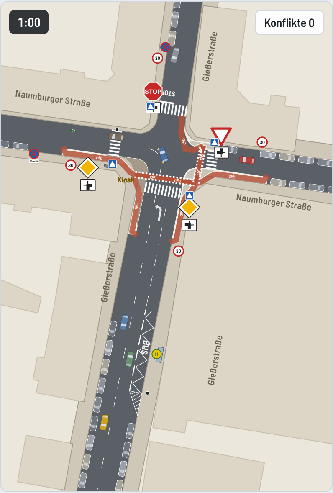

# SUMO-Modell Gießerstraße / Naumburger Straße

Mikroskopische Verkehrssimulation der Kreuzung in Leipzig-Plagwitz mit dem freien Simulator [Eclipse SUMO](https://eclipse.dev/sumo/). Das Modell vergleicht den Bestand mit drei Umbauvarianten und liefert Kennzahlen zu Sicherheit und Wartezeiten für die Bürgerkampagne. Das Browsermodell in `../modell` bleibt das Ideenmodell, dieses SUMO-Modell ist die nachvollziehbare Rechengrundlage.

**Abspieler im Browser** in [`grafik/abspieler.html`](grafik/abspieler.html). Die Datei im Browser öffnen, sie läuft ohne Internet (nur die Schrift kommt von Google Fonts). Fünf Minuten der Spitzenstunde je Variante mit 60 Bildern je Sekunde. Fahrzeuge lenken mit Schleppkurve, Gelenkbus und Sattelzug knicken, Blinker zeigen das Abbiegen, Beinahe-Unfälle blinken als Ringe auf.

| Bestand | Geschützte Kreuzung (angepasst) |
|---|---|
|  |  |

## Aufruf

```bash
pip install -r requirements.txt     # SUMO, matplotlib, shapely, pillow
python3 build.py                    # Netze und Nachfrage aller Varianten
python3 werkzeuge/schleppkurve.py   # Schleppkurven, legt die Inselkanten der geschützten Kreuzung fest
python3 run.py                      # 10 Läufe je Variante, etwa 2 Minuten
python3 plots.py                    # Vergleichsdiagramm und Netzbilder nach grafik/
python3 abspieler/export.py         # Browser-Abspieler grafik/abspieler.html
python3 werkzeuge/pruefe_abspieler.py   # Überlappungen und Bordstein im Abspieler prüfen
```

Weitere Schalter

- Standard ist der Regelbetrieb, die Busse fahren in beiden Richtungen zwischen Süd und West. `python3 build.py --bus SN` bildet die derzeitige Baustellenumleitung ab (Naumburger Straße ist Sackgasse, die Busse fahren geradeaus Süd und Nord, so steht es im Oktober 2026 auch in OpenStreetMap).
- `python3 run.py --laeufe 3 --varianten bestand geschuetzt` für schnelle Proben, `--varianten minikreisel` rechnet die verworfene Variante mit.
- `python3 run.py --nur-bericht` schreibt `vergleich.md` aus der vorhandenen CSV neu.
- `python3 werkzeuge/vorfahrt.py netze/bestand.net.xml J` zeigt, wer am Knoten auf wen wartet.
- Ansehen mit Oberfläche geht mit `sumo-gui -n netze/bestand.net.xml -r netze/bestand.rou.xml -a netze/haltestelle.add.xml`.

## Dateien

| Pfad | Inhalt |
|---|---|
| `build.py` | Liest die Geometrie aus `../daten/map.osm` und erzeugt je Variante Netz und Nachfrage. Alle Ortsbeobachtungen stehen hier als Konstanten |
| `strassenraum.py` | Fahrbahn, Inseln, Radwege und Pflaster als Flächen für Zeichnung und Prüfungen |
| `kinematik.py` | Lage der Fahrzeugglieder mit Schleppkurve (wie `rigidUpdate` und `artUpdate` im Browsermodell) und Blinker |
| `diagonal.py` | Fußgänger, die diagonal über den Knoten gehen (neben SUMO geführt) |
| `run.py` | Simuliert, wertet aus, schreibt `ergebnisse/kennzahlen.csv` und `ergebnisse/vergleich.md` |
| `plots.py` | Netzbilder und Vergleichsdiagramm |
| `abspieler/export.py`, `abspieler/vorlage.html` | Baut den Abspieler |
| `werkzeuge/schleppkurve.py` | Schleppkurven aller Fahrbeziehungen, `ergebnisse/schleppkurven.md` |
| `werkzeuge/pruefe_abspieler.py` | Prüft die fertige Seite auf sich überlappende Fahrzeuge und Fahrten über Bordstein und Inseln |
| `werkzeuge/vorfahrt.py` | Prüfhilfe für die Vorfahrtregeln |
| `netze/` | Erzeugte SUMO-Netze, Nachfrage, Haltestelle, Schleppkurvenflächen |
| `ergebnisse/` | Kennzahlen je Lauf, Vergleichstabelle, Schleppkurven. Rohdaten unter `roh/` werden nicht eingecheckt |

## Ortsbeobachtung der Initiative

Die Initiative hat im Oktober 2026 Luftbilder (Geoportal Leipzig, Google), Straßenfotos (Google Street View 2023 und 2026) und eigene Beobachtungen beigesteuert. Die Bilder liegen nicht im Repository (Urheberrecht). Übernommen ist

| Punkt | Beobachtung | Im Modell |
|---|---|---|
| Busse 60 und 60E | Regelbetrieb in beiden Richtungen Süd nach West und West nach Süd. Derzeit wegen Baustelle umgeleitet (Naumburger Straße Sackgasse) | Takt 10 min je Richtung, Umleitung mit `--bus SN` |
| Haltestelle Süd | Halt auf der rechten Fahrbahnseite mit BUS und Zickzack, durch breite Strichlinie getrennt, am Südende ein Keil als Einfahrt, Wartehäuschen auf dem Ostgehweg. Südlich davon wird am rechten Rand geparkt, der Bus fährt dort auf der Fahrspur und schwenkt erst am Keil ein | Parkstreifen Ostseite ab 70 m, Haltebereich 45 bis 70 m nur für Bus und Rad, dahinter zwei Spuren |
| Bus Süd nach West nach dem Halt | muss von ganz rechts auf die Linksabbiegespur wechseln | eigene Kennzahl Spurwechsel und Konflikte dabei |
| Südarm Markierung | zwei Spuren nordwärts mit Pfeilen links bzw. geradeaus und rechts, links daneben eine schmale Sperrfläche, Leitlinie als Bogen durch den Knoten nach West | gezeichnet, nur der Südarm hat Markierung |
| Fehlverhalten Süd | etwa ein Viertel der Geradeausfahrer nach Nord nutzt die Linksabbiegespur oder fährt mittig | 25 % im Bestand über eine nur dafür freigegebene Verbindung (Fahrzeugklasse `taxi`), im Abspieler orange und mittig. Mit Tempo 30 15 %, mit Inseln 5 % |
| Nordarm | 8,2 m, Westseite Längsparken mit Begrenzungslinie ab etwa 30 m, davor Halteverbot (Schild). STOP-Feld und Haltlinie. Fußgänger queren zwischen Haltlinie und Knoten direkt vor dem wartenden Auto | Parkstreifen ab 30 m (Fahrspuren dort 3,1 m), Haltlinie nördlich der Querung |
| Zufluss Nord | am Stoppschild warten häufig 1 bis 3 Fahrzeuge | siehe Nachfrage |
| Naumburger West | keine Mittelmarkierung, Tempo-30-Zone ab dem Knoten (274.1), Südseite Parken erst ab etwa 30 m vor der Knotenkante, davor Halteverbot Mo bis Fr (Zeit unleserlich), Nordseite kein Parken | in der Spitzenstunde werktags frei von Parkern, Halteverbotsschild mit Zusatz Mo–Fr gezeichnet |
| Naumburger Ost | keine Markierung, Nordseite Parken bis an die Ecke, Südseite ab etwa 10 m, Restfahrbahn nur etwa einspurig (4,5 bis 5 m) | Parken so gezeichnet, zwei schmale Spuren je 2,75 m. Begegnungswarten bildet SUMO nicht ab (Vereinfachung) |
| Ostarm Schild | Vorfahrt gewähren (205) mit Zusatz abknickende Vorfahrt auf der Nordseite | gezeichnet |
| Südarm Schild | Vorfahrtstraße (306) mit Zusatz 1002 auf der Ostseite kurz vor dem Knoten | gezeichnet |
| Westarm Schild | Vorfahrtstraße (306) mit Zusatz 1002 auf der Südseite kurz vor dem Knoten | gezeichnet |
| Querungen | Nord zwischen Haltlinie und Knoten (meistgenutzt, etwa 100 je Stunde), Ost direkt an der Knotenkante, West nah am Knoten in Wunschlinie zum Kiosk | Querungsknoten unmittelbar am Knotenrand |
| Diagonalquerer | ein Teil des Kioskstroms geht schräg über den Knoten zwischen Nordost- und Südwestecke | etwa 10 Personen je Stunde, 20 % des Kioskstroms, siehe unten |
| Kiosk Südwestecke | „Lebensmittel A. Prinz“ in der abgeschrägten Hausecke, Bordstein folgt der Abschrägung | gezeichnet |
| Schaltkasten | großer Verteilerkasten mit Werbung auf dem Gehweg der Naumburger Seite an der Südwestecke, Sichthindernis für Fußgänger vom Kiosk über die Westquerung und für Fahrer Süd nach West | gezeichnet. Die Sichtbehinderung ist nicht eigens modelliert (dokumentierte Annahme, die Konflikte an der Westquerung sind eher unterschätzt) |
| Baustellenschilder 2023 | Halteverbot und Gefahrzeichen an der Kioskecke waren mobil | nicht gezeichnet |

## Modellaufbau

**Geometrie.** Lage und Richtung der vier Arme stammen aus OpenStreetMap (Knoten 60015219). Jeder Arm ist eine Gerade von 120 m. Die Breiten sind mit Luftbild und OSM abgeglichen. Parkstreifen sind Spuren ohne Verkehr und legen den Bordstein fest.

| Arm | Fahrbahn | Querschnitt |
|---|---|---|
| Gießerstraße Süd | 13,0 m | West Parkstreifen 2,2 (geparkt erst ab 45 m), südwärts 3,6, nordwärts 7,2 (südlich der Haltestelle Parken 2,4 und eine breite Spur, Haltebereich, dann zwei Spuren) |
| Gießerstraße Nord | 8,2 m | je Richtung 4,1, ab 30 m Westseite Parken 2,0 und zwei Spuren je 3,1 |
| Naumburger West | 9,5 m | Südseite Parkstreifen 2,0, je Richtung 3,75 |
| Naumburger Ost | 9,5 m | beidseitig Parken 2,0, je Richtung 2,75 |

Die Nordecken sind mit 5 m ausgerundet, die Südecken wie die Hausecken abgeschrägt. Rechtsabbieger West nach Süd und Nord nach West fahren eine weitere Bahn als die Standardbahn von netconvert (`WEITE_KURVEN` in `build.py`), sonst würde schon ein Pkw mit dem Heck den Bordstein streifen.

**Vorfahrt im Bestand.** Abknickende Vorfahrt Süd nach West, Stoppschild Nord (Halt 1 s an der Haltlinie), Ost wartepflichtig, zwischen Nord und Ost rechts vor links. Wer aus West geradeaus nach Ost fährt, wartet auf den Strom Süd nach West.

**Varianten**

| Variante | Änderungen gegenüber Bestand |
|---|---|
| `bestand` | wie oben, Tempo laut OSM (Süd, Nord und Ost 50, West Tempo-30-Zone) |
| `rvl` | Rechts vor links an allen Armen, Tempo 30 überall, Querungen ohne Markierung |
| `t30_zebra` | Bestand mit Tempo 30 überall und Zebrastreifen Nord und West |
| `geschuetzt` | Geschützte Kreuzung nach niederländischem Vorbild, an den Platz angepasst (siehe unten) |
| `minikreisel` | nur noch Referenz, nicht im Vergleich (siehe unten) |

**Geschützte Kreuzung, angepasst.** Vorlage war die Grafik der Initiative und der Beitrag des Mobilitätsforums Bund (`../recherche/04-geschuetzte-kreuzung.md`). An der Nordost- und der Nordwestecke stehen die Häuser nur 1 bis 2 m hinter der Bordsteinkante. Ein Radweg hinter einer Insel mit abgesetzter Furt passt dort nicht, ein Ring um den ganzen Knoten würde durch die Häuser führen. Umgesetzt ist deshalb, was der Platz hergibt.

- Eckinseln an der Südwest-, Südost- und Nordostecke anstelle der ersten Meter Parken, enge Fahrbahnecken.
- Radwege hinter den Inseln auf Naumburger West Süd, Gießerstraße Süd beidseitig und Naumburger Ost Süd, jeweils etwa 30 m vor dem Knoten beginnend.
- Abgesetzte Radfurt über den Südarm (ostwärts, 4,5 m hinter der Fahrbahnkante der Naumburger Straße, Rad wartet) und über den Ostarm (nordwärts, Rad hat Vorrang wie die Hauptrichtung). Linksabbiegen West nach Nord und Süd nach Nord geht damit indirekt über die Furten. Von der Nordostecke fahren die Räder am Fahrbahnrand zurück auf den Nordarm.
- Nord- und Westarm behalten den Radverkehr auf der Fahrbahn, Linksabbiegen Süd nach West auch.
- Zebrastreifen an allen Armen, hinter den Radfurten. Tempo 30. Vorfahrt und Stoppschild wie heute.
- Die Inselkante folgt der Fläche, die ein Pkw beim Abbiegen braucht (`werkzeuge/schleppkurve.py`). Was Bus, Lkw und Sattelzug darüber hinaus brauchen, ist als überfahrbares Pflaster gezeichnet.
- Für ein wartendes Auto zwischen Knoten und Furt ist kein Platz, die Furten liegen direkt am Knotenrand. Das ist der wesentliche Unterschied zum Vorbild.

**Minikreisel verworfen.** Ein 18 m Gelenkbus von Süd nach West müsste fast die ganze Mitte überfahren, der Nordarm ist nur 8,2 m breit und der Knoten ist für einen Kreisel mit ausreichendem Durchmesser zu klein. Der Minikreisel bleibt im Build als Referenz, ist aber nicht mehr im Vergleich und nicht im Abspieler.

**Nachfrage.** Spitzenstunde aus dem Browsermodell (`../modell/src/sim.js`, `DEMAND`), angepasst nach Beobachtung. Pkw, Lkw, Sattelzüge und Räder kommen zufällig (Poisson), die Busse im 10-Minuten-Takt je Richtung.

| Gruppe | je Stunde |
|---|---|
| Pkw | etwa 970, davon Süd nach West 260 und West nach Süd 240 |
| aus Nord | 224 Kfz (Süd 60 %, West 35 %, Ost 5 %). Gewünscht waren etwa 300, damit ist der Nordarm im Modell aber überlastet (Zeitverlust 80 bis 290 s, wachsende Schlange). Mit 224 wartet in der Hälfte der Zeit mindestens ein Fahrzeug, in einem Viertel der Zeit zwei oder mehr |
| Lkw und Sattelzüge | 33 |
| Gelenkbusse 18 m | 12 (6 je Richtung Süd nach West und West nach Süd) |
| Rad | 198 |
| Fußgänger | etwa 160 Wege mit Querungen Nord etwa 100, West 50, Süd 30, Ost 30, dazu 10 Diagonalquerer |

**Diagonalquerer.** SUMO kann keine Querung schräg über den ganzen Knoten abbilden. Diese Personen führt `diagonal.py` neben SUMO. Sie warten an der Ecke, bis kein fahrendes Fahrzeug näher als 20 m an der Knotenmitte ist (nach 25 s Warten genügen 9 m), und gehen dann gerade hinüber. Die Fahrzeuge reagieren nicht auf sie. Gezählt wird wie bei den anderen Fußgängern, wie oft ein Fahrzeug über 15 km/h stärker als 3 m/s² bremsen müsste. In der geschützten Kreuzung erschweren die Inseln das, sind aber kein Hindernis im Modell.

**Fahrzeugkinematik im Abspieler.** SUMO liefert die Position der Fahrzeugfront. Die Vorderachse folgt dieser Bahn, die Hinterachse läuft als Schleppkurve nach. Gelenkbus 18 m (Vorderteil mit Radstand 5,9 m, Gelenk 1,6 m hinter der Mittelachse, Nachläufer 5,9 m) und Sattelzug (Zugmaschine 3,7 m, Auflieger 7,8 m) haben zwei Glieder, beim Bus führen Mittel- und Hinterachse wie bei einer gelenkten Nachlaufachse teilweise zur Bahn zurück. Die Werte stammen aus dem Browsermodell. SUMO selbst rechnet mit geraden Fahrzeugen. Wo ein ausschwenkendes Heck ein Nachbarfahrzeug berührt, sieht man das im Abspieler, SUMO weiß davon nichts.

## Kennzahlen

| Kennzahl | Definition |
|---|---|
| Fahrzeugkonflikte | SUMO-Gerät SSM, gezählt wenn TTC unter 1,5 s, PET unter 1 s oder DRAC über 3 m/s², jeweils ab 15 km/h und nur im Knotenbereich bis 22 m um die Mitte (alle Varianten gleich). Schwer heißt TTC unter 1 s oder PET unter 0,5 s. Getrennt ausgewiesen Kfz gegen Rad, mit Bus oder Lkw und mit Fehlspur-Fahrern |
| Fußgängerkonflikte | Eigene Auswertung der Bewegungsdaten. Eine Person steht auf einer Querung und ein Fahrzeug über 15 km/h müsste stärker als 3 m/s² bremsen. Diagonalquerer extra |
| Nordarm | wartende Fahrzeuge im Mittel und höchstens, Anteil der Zeit mit 1, 2 oder 3 und mehr Wartenden |
| Bus Spurwechsel | Busse Süd nach West, die nach dem Halt auf die Linksabbiegespur wechseln, und Konflikte dieser Busse 4 s vor bis 6 s nach dem Wechsel |
| Bordstein und Inseln | Fahrzeugumrisse mit Schleppkurve gegen die Fahrbahnfläche, je Fahrt gezählt, wenn ein Glied mehr als 0,2 m² über Bordstein bzw. Insel oder Pflaster ragt |
| Zeitverlust, Rückstau, Qualitätsstufe | wie zuvor, Qualitätsstufe nach den Grenzen des HBS 2015 für Knoten ohne Ampel, vereinfacht, am Original prüfen |

Gezählt wird die Stunde nach 10 Minuten Einschwingzeit, Mittel aus 10 Läufen mit festen Startwerten.

## Ergebnisse

Vollständige Tabellen in [`ergebnisse/vergleich.md`](ergebnisse/vergleich.md), Schleppkurven in [`ergebnisse/schleppkurven.md`](ergebnisse/schleppkurven.md).


Kernaussagen je Stunde (Mittel aus 10 Läufen)

| | Bestand | Rechts vor links, T30 | T30 und Zebra | Geschützt (angepasst) |
|---|---|---|---|---|
| Fahrzeugkonflikte im Knoten | 48 | 16 | 41 | 82 |
| davon schwer | 12 | 0,6 | 14 | 28 |
| davon Kfz gegen Rad | 11 | 5 | 12 | 25 |
| Fußgänger auf Querung bedrängt | 20 | 19 | 21 | 25 |
| Fußgänger diagonal bedrängt | 8,6 | 7,1 | 7,8 | 8,3 |
| Wartezeit Fußgänger in s | 4,3 | 7,0 | 2,9 | 0,3 |
| Nordarm Zeitverlust Kfz in s | 41 (D) | 8 (A) | 38 (D) | 15 (B) |
| Nordarm Anteil der Zeit mit Wartenden | 53 % | 8 % | 51 % | 29 % |
| Zeitverlust Kfz in s | 16 | 9 | 15 | 11 |

Lesart

- **Rechts vor links mit Tempo 30** schneidet bei den Fahrzeugkonflikten mit Abstand am besten ab. Schwere Konflikte fallen fast ganz weg, der Nordarm staut sich kaum noch. Fußgänger warten etwas länger, weil es weiter keine Zebrastreifen gibt.
- **Tempo 30 mit Zebrastreifen** ändert bei unveränderter Vorfahrt wenig an den Fahrzeugkonflikten. Fußgänger warten kürzer, Fahrzeuge über 30 km/h vor den Querungen werden seltener.
- **Die angepasste geschützte Kreuzung** verkürzt Wartezeiten und Rückstau, im Modell steigen aber die Konflikte, besonders Kfz gegen Rad. Ursache ist die Enge. Die Radfurten liegen direkt am Knotenrand, Abbieger treffen gleich nach dem Abbiegen auf querende Räder und haben keinen Platz zum Warten. Das deckt sich mit der Kritik der FGSV und der UDV am Konzept bei fehlendem Seitenraum. Das Modell ist an dieser Stelle empfindlich für die SUMO-Knotengeometrie, die Zahl ist als Warnzeichen zu lesen, nicht als genauer Wert.
- **Schleppkurven.** Rechtsabbieger West nach Süd um die Kioskecke sind für Gelenkbus, Lkw und Sattelzug eng, sie überstreichen auf der Spurmitte 20 bis 60 m² außerhalb der Fahrbahn. Real holen die Fahrer in die Gegenfahrbahn aus. In der geschützten Kreuzung fahren Bus, Lkw und Sattelzug planmäßig über das Pflaster der Inseln.
- **Bus nach West.** Der Wechsel vom Haltebereich auf die Linksabbiegespur passiert in etwa 1 bis 3 Fahrten je Stunde im Modell direkt vor dem Knoten, Konflikte dabei sind selten (unter 0,5 je Stunde).
- **Fehlspur.** Geradeausfahrer aus der Linksabbiegespur verursachen im Modell nur wenige Konflikte (unter 1 je Stunde). SUMO lässt sie sauber einfädeln, das real beobachtete Verunsichern von Fußgängern und Gegenverkehr bildet es kaum ab.

## Überlappungen von Fahrzeugen

SUMO kann Fahrzeuge im Knoten übereinanderschieben, wenn die Vorfahrtlogik eine Lage nicht erkennt. Das ist ein Modellfehler, kein Unfall, und wird je Lauf gezählt (unter 1 je Stunde in allen Varianten). Die Querungen liegen auf eigenen kleinen Knoten am Knotenrand, in der geschützten Kreuzung haben Furt-, Zebra- und Abzweigknoten feste Knotenflächen, weil netconvert die Knoten bei parallel einlaufenden Rad-, Geh- und Fahrbahnkanten sonst aufbläht. `werkzeuge/pruefe_abspieler.py` findet im Abspieler je Variante 0 bis 4 kurze Berührungen, meist das ausschwenkende Heck eines Busses neben einem Pkw.

## Grenzen

- Die Nachfrage ist geschätzt, es gibt keine Zählung. Das Modell zeigt Unterschiede zwischen Varianten, nicht die echten Werte.
- Die Wartezeit am Nordarm hängt stark von Lückenannahme (`impatience 0.5`) und Zufluss ab.
- Parken bestimmt nur die Geometrie, Ein- und Ausparken und das Begegnungswarten im Ostarm fehlen.
- An Zebrastreifen gehen SUMO-Fußgänger ohne Blick auf den Verkehr los, Konflikte dort sind eher überschätzt.
- Diagonalquerer und der Schaltkasten als Sichthindernis sind vereinfacht bzw. nur dokumentiert.
- SSM meldet zusätzlich Überschneidungen von Fahrzeugumrissen im Knoteninneren (Typ 111). In der geschützten Kreuzung sind das wegen der engen Knotenfläche mehr (etwa 14 je Stunde). Sie sind nicht mitgezählt.
- Eine Untervariante der geschützten Kreuzung mit rechts vor links ist nicht gerechnet. Nach den Ergebnissen wäre sie der naheliegende nächste Fall.

## Nächste Schritte

1. Zählung in der Spitzenstunde (Knotenstromzählung, gern per Video) und die Nachfrage in `build.py` ersetzen.
2. Unfalldaten der Polizei mit den Konfliktschwerpunkten vergleichen.
3. Variante rechts vor links mit Gehwegvorstreckungen und Zebrastreifen Nord, die Elemente der geschützten Kreuzung nutzt, die hier Platz haben.
