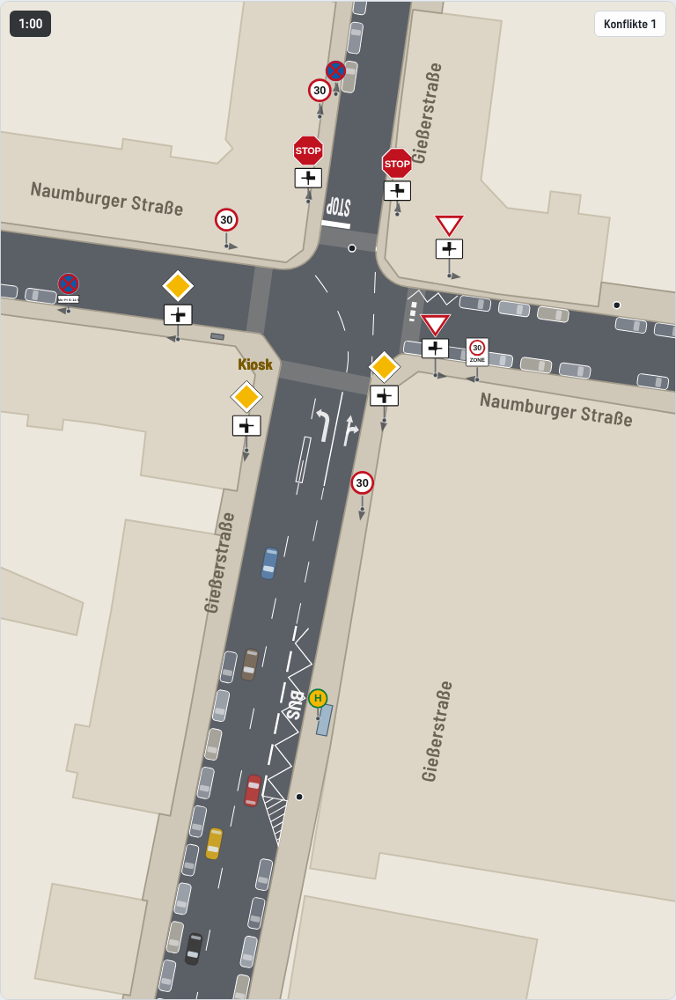
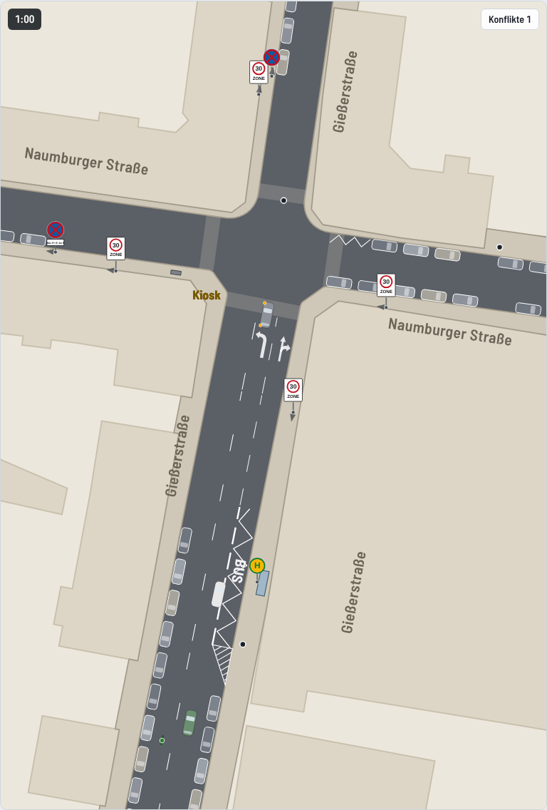
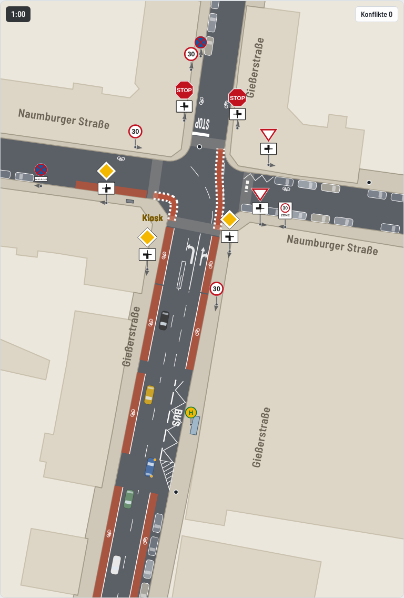

# SUMO-Modell Gießerstraße / Naumburger Straße

Mikroskopische Verkehrssimulation der Kreuzung in Leipzig-Plagwitz mit dem freien Simulator [Eclipse SUMO](https://eclipse.dev/sumo/). Das Modell vergleicht den Bestand mit drei Varianten, die die Initiative im Oktober 2026 ausgewählt hat (bessere Markierung mit Tempo 30, Tempo-30-Zone mit rechts vor links, rote Radwege), und liefert Kennzahlen zu Sicherheit und Wartezeiten für die Bürgerkampagne. Das Browsermodell in `../modell` bleibt das Ideenmodell, dieses SUMO-Modell ist die nachvollziehbare Rechengrundlage.

**Abspieler im Browser** in [`grafik/abspieler.html`](grafik/abspieler.html). Die Datei im Browser öffnen, sie läuft ohne Internet (nur die Schrift kommt von Google Fonts). Fünf Minuten der Spitzenstunde je Variante mit 60 Bildern je Sekunde. Spurwechsel dauern einige Sekunden, Bus und Lkw holen beim Abbiegen aus, Gelenkbus und Sattelzug knicken, Blinker zeigen das Abbiegen, Beinahe-Unfälle blinken als Ringe auf. Verkehrszeichen sind nach StVO-Vorlage gezeichnet, mit Mast und einer Marke, die zum jeweiligen Fahrer zeigt.

| Bestand | Markierung und Tempo 30 |
|---|---|
|  |  |
| **Tempo-30-Zone, rechts vor links** | **Rote Radwege** |
|  |  |

## Aufruf

```bash
pip install -r requirements.txt     # SUMO, matplotlib, shapely, pillow
python3 build.py                    # Netze und Nachfrage aller Varianten
python3 werkzeuge/schleppkurve.py   # Schleppkurven der Fahrbeziehungen
python3 run.py                      # 10 Läufe je Variante, etwa 2 Minuten
python3 plots.py                    # Vergleichsdiagramm und Netzbilder nach grafik/
python3 abspieler/export.py         # Browser-Abspieler grafik/abspieler.html
python3 werkzeuge/pruefe_abspieler.py   # Überlappungen, Bordstein und Knickwinkel im Abspieler prüfen
python3 werkzeuge/screenshots.py 60 grafik  # Bilder der Varianten nach 60 s
python3 werkzeuge/szenenbilder.py /tmp      # Bilder der kritischen Szenen
```

Weitere Schalter

- Standard ist der Regelbetrieb, die Busse fahren in beiden Richtungen zwischen Süd und West. `python3 build.py --bus SN` bildet die derzeitige Baustellenumleitung ab (Naumburger Straße ist Sackgasse, die Busse fahren geradeaus Süd und Nord, so steht es im Oktober 2026 auch in OpenStreetMap).
- `python3 run.py --laeufe 3 --varianten bestand radwege` für schnelle Proben. Die verworfenen Varianten (`rvl`, `t30_zebra`, `geschuetzt`, `minikreisel`) baut `python3 build.py --alt`, danach lassen sie sich mit `--varianten` rechnen.
- `python3 run.py --nur-bericht` schreibt `vergleich.md` aus der vorhandenen CSV neu.
- `python3 werkzeuge/vorfahrt.py netze/bestand.net.xml J` zeigt, wer am Knoten auf wen wartet.
- Ansehen mit Oberfläche geht mit `sumo-gui -n netze/bestand.net.xml -r netze/bestand.rou.xml -a netze/haltestelle.add.xml`.

## Dateien

| Pfad | Inhalt |
|---|---|
| `build.py` | Liest die Geometrie aus `../daten/map.osm` und erzeugt je Variante Netz und Nachfrage. Alle Ortsbeobachtungen stehen hier als Konstanten |
| `strassenraum.py` | Fahrbahn, Inseln, Radwege und Pflaster als Flächen für Zeichnung und Prüfungen |
| `kinematik.py` | Lage der Fahrzeugglieder mit Schleppkurve (wie `rigidUpdate` und `artUpdate` im Browsermodell) und Blinker |
| `diagonal.py` | Fußgänger, die diagonal über den Knoten gehen (neben SUMO geführt) |
| `run.py` | Simuliert, wertet aus, schreibt `ergebnisse/kennzahlen.csv` und `ergebnisse/vergleich.md` |
| `plots.py` | Netzbilder und Vergleichsdiagramm |
| `abspieler/export.py`, `abspieler/vorlage.html` | Baut den Abspieler |
| `abspieler/szenen.py` | Sucht die kritischen Szenen in den Rohdaten von `run.py` |
| `werkzeuge/schleppkurve.py` | Schleppkurven aller Fahrbeziehungen, `ergebnisse/schleppkurven.md` |
| `werkzeuge/pruefe_abspieler.py` | Prüft die fertige Seite auf sich überlappende Fahrzeuge und Fahrten über Bordstein und Inseln |
| `werkzeuge/vorfahrt.py` | Prüfhilfe für die Vorfahrtregeln |
| `netze/` | Erzeugte SUMO-Netze, Nachfrage, Haltestelle, Schleppkurvenflächen |
| `ergebnisse/` | Kennzahlen je Lauf, Vergleichstabelle, Schleppkurven. Rohdaten unter `roh/` werden nicht eingecheckt |

## Ortsbeobachtung der Initiative

Die Initiative hat im Oktober 2026 Luftbilder (Geoportal Leipzig, Google), Straßenfotos (Google Street View 2023 und 2026, eigene Fotos) und Beobachtungen beigesteuert. Fremde Bilder liegen nicht im Repository (Urheberrecht). Übernommen ist

| Punkt | Beobachtung | Im Modell |
|---|---|---|
| Busse 60 und 60E | Regelbetrieb in beiden Richtungen Süd nach West und West nach Süd. Derzeit wegen Baustelle umgeleitet (Naumburger Straße Sackgasse) | Takt 10 min je Richtung, Umleitung mit `--bus SN` |
| Haltestelle Süd | Halt auf der rechten Fahrbahnseite mit BUS und Zickzack, durch breite Strichlinie getrennt, am Südende ein Keil als Einfahrt, Wartehäuschen auf dem Ostgehweg. Südlich davon wird am rechten Rand geparkt, der Bus fährt dort auf der Fahrspur und schwenkt erst am Keil ein | Parkstreifen Ostseite ab 70 m, Haltebereich 45 bis 70 m nur für Bus und Rad, dahinter zwei Spuren |
| Bus Süd nach West nach dem Halt | muss von ganz rechts auf die Linksabbiegespur wechseln | eigene Kennzahl Spurwechsel und Konflikte dabei |
| Spurwechsel und Abbiegen | Spurwechsel dauern in echt einige Sekunden (Pkw 5 bis 6 s, Bus und Lkw 6 bis 8 s), Busse knicken beim Anfahren nicht, Bus und Lkw holen beim Rechtsabbiegen aus | Spurwechsel in SUMO 6 s, im Abspieler weich über 30 bis 60 m, Ausholen und Knickgrenze, siehe Fahrzeugkinematik |
| Süd nach Nord | viele fahren zügig geradeaus durch | 200 statt 110 Pkw je Stunde, 20 % schnelle Fahrer (Schätzung) |
| Blinken | Geradeausfahrer blinken nie, auch nicht beim Spurwechsel, Abbieger meistens | im Abspieler so gezeichnet, siehe Kritische Szenen |
| Südarm Markierung | zwei Spuren nordwärts mit Pfeilen links bzw. geradeaus und rechts, links daneben eine schmale Sperrfläche. Gestrichelte Leitlinie mit großem Radius von der Linie zwischen Links- und Geradeausspur zur Nordwestecke, sie trennt die abknickende Vorfahrt vom Geradeausverkehr. Zweite schräge Linie von der Südost- zur Nordostecke über die Mündung des Ostarms | gezeichnet |
| Fehlverhalten Süd | etwa ein Viertel der Geradeausfahrer nach Nord nutzt die Linksabbiegespur oder fährt mittig | 25 % im Bestand über eine nur dafür freigegebene Verbindung (Fahrzeugklasse `taxi`), im Abspieler orange und mittig. Mit durchgezogener Linie (Markierung, Radwege) 8 %, in der Zone 15 % |
| Nordarm | 8,2 m, Westseite Längsparken mit Begrenzungslinie ab etwa 30 m, davor Halteverbot (Schild). STOP-Feld und Haltlinie | Parkstreifen ab 30 m (Fahrspuren dort 3,1 m), Haltlinie vor der Querung, STOP für Fahrer aus Norden lesbar |
| Zufluss Nord | am Stoppschild warten häufig 1 bis 3 Fahrzeuge | siehe Nachfrage |
| Naumburger West | keine Mittelmarkierung, Tempo 30 per Streckenschild (274, Lärmaktionsplan seit 12/2025, OSM `maxspeed=30 sign`). Südseite Parken erst ab etwa 30 m vor der Knotenkante, davor Halteverbot Mo bis Fr 6 bis 14 Uhr (mit Wegweiser „Amt für Jugend, Familie und Bildung“), Nordseite kein Parken | Das Modell rechnet die Morgenspitze, dort ist der Abschnitt frei. Nachmittags ab 14 Uhr stehen dort Parker |
| Naumburger Ost | Tempo-30-Zone (274.1 kurz hinter dem Knoten auf der Südseite, Foto der Initiative). Die frühere Annahme Tempo 50 nach OSM war falsch. Keine Markierung, Nordseite Parken bis an die Ecke, Südseite ab etwa 10 m, Restfahrbahn nur etwa einspurig (4,5 bis 5 m) | Tempo 30, Parken so gezeichnet, zwei schmale Spuren je 2,75 m. Begegnungswarten bildet SUMO nicht ab (Vereinfachung) |
| Schilder | Süd und West Vorfahrtstraße (306) mit Zusatz 1002, Nord Halt (206), Ost Vorfahrt gewähren (205), beide mit Zusatz 1002 | nach StVO-Vorlage gezeichnet, 1002 aus Sicht des jeweiligen Fahrers (eigene Zufahrt unten) |
| Querungen | Fußgänger queren so früh wie möglich, also direkt am Beginn der Eckausrundung. Nord zwischen Haltlinie und Knoten (meistgenutzt, etwa 100 je Stunde), Ost direkt an der Knotenkante, West in Wunschlinie zum Kiosk | Querungsachse 0,5 m hinter dem Beginn der Ausrundung (Süd 9,7 m, Nord 10,3 m, West 11,3 m, Ost 10,7 m von der Knotenmitte). Näher geht in SUMO nicht, weil jede Querung einen eigenen Knoten am Rand des Hauptknotens braucht |
| Diagonalquerer | wenige Leute gehen schräg über den Knoten zum Kiosk, aber nur, wenn wirklich frei ist | siehe unten, ohne Gewicht im Vergleich |
| Kiosk Südwestecke | „Lebensmittel A. Prinz“ in der abgeschrägten Hausecke, Bordstein folgt der Abschrägung | gezeichnet |
| Schaltkasten | großer Verteilerkasten mit Werbung auf dem Gehweg der Naumburger Seite an der Südwestecke, Sichthindernis | gezeichnet, Sichtbehinderung nicht modelliert |
| Baustellenschilder 2023 | Halteverbot und Gefahrzeichen an der Kioskecke waren mobil | nicht gezeichnet |

## Modellaufbau

**Geometrie.** Lage und Richtung der vier Arme stammen aus OpenStreetMap (Knoten 60015219). Jeder Arm ist eine Gerade von 120 m. Die Breiten sind mit Luftbild und OSM abgeglichen. Parkstreifen sind Spuren ohne Verkehr und legen den Bordstein fest.

| Arm | Fahrbahn | Querschnitt |
|---|---|---|
| Gießerstraße Süd | 13,0 m | West Parkstreifen 2,2 (geparkt erst ab 45 m), südwärts 3,6, nordwärts 7,2 (südlich der Haltestelle Parken 2,4 und eine breite Spur, Haltebereich, dann zwei Spuren) |
| Gießerstraße Nord | 8,2 m | je Richtung 4,1, ab 30 m Westseite Parken 2,0 und zwei Spuren je 3,1 |
| Naumburger West | 9,5 m | Südseite Parkstreifen 2,0, je Richtung 3,75 |
| Naumburger Ost | 9,5 m | beidseitig Parken 2,0, je Richtung 2,75 |

Die Nordecken sind mit 5 m ausgerundet, die Südecken wie die Hausecken abgeschrägt. Rechtsabbieger West nach Süd und Nord nach West fahren eine weitere Bahn als die Standardbahn von netconvert (`WEITE_KURVEN` in `build.py`), sonst würde schon ein Pkw mit dem Heck den Bordstein streifen.

**Vorfahrt im Bestand.** Abknickende Vorfahrt Süd nach West, Stoppschild Nord (Halt 1 s an der Haltlinie), Ost wartepflichtig, zwischen Nord und Ost rechts vor links. Wer aus West geradeaus nach Ost fährt, wartet auf den Strom Süd nach West.

**Varianten**

| Variante | Änderungen gegenüber Bestand |
|---|---|
| `bestand` | wie oben. Gießerstraße 50, Naumburger West 30 (Streckenschild), Naumburger Ost Tempo-30-Zone |
| `markierung` | Vorfahrt wie heute, Tempo 30 auf allen Armen streckenbezogen (Zeichen 274). Eine Tempo-30-Zone ist hier nicht möglich, weil Zonen nach VwV-StVO keine Vorfahrtstraßen umfassen dürfen. Klarer Bogen der Vorfahrt, durchgezogene Fahrstreifenbegrenzung (295) zwischen Links- und Geradeausspur auf den letzten 15 m, dadurch nur noch 8 % Fehlspur (Annahme, wer geradeaus aus der Linksabbiegespur fährt, überfährt eine durchgezogene Linie). Grenzmarkierung (299) an der Nordseite des Ostarms auf den ersten 7 m, damit Sichtfeld frei. Breitere Haltlinie Nord und Wartelinie Ost, Schilder 206 und 205 zusätzlich links, 306 zusätzlich links am Südarm. Keine Zebrastreifen |
| `zone` | Tempo-30-Zone (274.1) an allen Zufahrten, damit rechts vor links an allen Armen, alle Vorfahrtschilder und Wartelinien entfallen. Grenzmarkierung an der Ostecke wie oben. Keine Zebrastreifen. Fehlspur 15 % (Pfeile bleiben) |
| `radwege` | wie `markierung`, dazu rot eingefärbte Radfahrstreifen (Breitstrich, Breiten nach ERA 2010). Gießerstraße Süd nordwärts 1,85 m am rechten Rand (Haltebereich wie heute gemeinsam mit dem Bus, südlich davon 0,5 m Sicherheitstrennstreifen zu den Parkern), südwärts 2,0 m statt des Parkstreifens auf der Westseite. Naumburger West Richtung Knoten 1,85 m auf den letzten 30 m im heutigen Halteverbot. Rote Furten durch den Knoten West nach Süd und Süd nach Nord. Westwärts (3,75 m), Nord (8,2 m) und Ost (Engstelle) reicht die Breite nicht, dort Piktogramme. Linksabbiegen Süd nach West auf der Linksabbiegespur, indirektes Linksabbiegen und aufgeweiteter Radaufstellstreifen wurden geprüft, passen ohne Ampel aber nicht sinnvoll |

Die Vorfahrtstraße mit Radfahrstreifen ist bewusst die Basis der Variante `radwege`. In einer Tempo-30-Zone sind Radfahrstreifen nach VwV-StVO in der Regel nicht vorgesehen.

**Parkplätze im Modellausschnitt** (je Arm 120 m, ohne zufällige Lücken gezählt)

| Variante | Stellplätze | Unterschied |
|---|---|---|
| Bestand | 88 | |
| Markierung und Tempo 30 | 87 | −1 an der Nordseite des Ostarms (Grenzmarkierung) |
| Tempo-30-Zone | 87 | −1 wie oben |
| Rote Radwege | 74 | −14, davon 13 auf der Westseite der Gießerstraße Süd (45 bis 120 m) und 1 am Ostarm. Jenseits des Modellausschnitts kostet der Radfahrstreifen dort etwa 18 Plätze je 100 m. Dazu entfallen auf der Naumburger West die etwa 5 Plätze, die heute nachmittags ab 14 Uhr im Halteverbotsabschnitt genutzt werden |

**Verworfene Varianten.** Die Initiative hat nach den ersten Ergebnissen entschieden, Zebrastreifen, die geschützte Kreuzung und den Minikreisel nicht weiter zu verfolgen. Sie lassen sich mit `python3 build.py --alt` weiter bauen. Die letzten Kennzahlen (Stand Commit dc05a94, damals noch mit Querungen weiter vom Knoten, Ost Tempo 50, ohne Spurwechseldauer) stehen in `ergebnisse/vergleich_alt_stand_dc05a94.md`.

| Variante | Grund | Fahrzeugkonflikte je Stunde | davon schwer | Kfz gegen Rad |
|---|---|---|---|---|
| Rechts vor links, Tempo 30, ohne Markierung | aufgegangen in der Variante Tempo-30-Zone | 16 | 0,6 | 5 |
| Tempo 30 mit Zebra Nord und West | Zebrastreifen hier unrealistisch (Einschätzung der Initiative), kaum Wirkung auf die Fahrzeugkonflikte | 41 | 14 | 12 |
| Geschützte Kreuzung (angepasst) | an den Nordecken kein Platz für Radwege hinter Inseln, Furten direkt am Knotenrand, im Modell mehr Konflikte | 82 | 28 | 25 |
| Minikreisel | 18 m Gelenkbus Süd nach West, Nordarm 8,2 m, Knoten zu klein | nicht mehr gerechnet | | |

**Nachfrage.** Spitzenstunde aus dem Browsermodell (`../modell/src/sim.js`, `DEMAND`), angepasst nach Beobachtung. Pkw, Lkw, Sattelzüge und Räder kommen zufällig (Poisson), die Busse im 10-Minuten-Takt je Richtung.

| Gruppe | je Stunde |
|---|---|
| Pkw | etwa 1060, davon Süd nach West 260, West nach Süd 240 und Süd nach Nord 200 (nach Beobachtung erhöht, Schätzung) |
| aus Nord | 224 Kfz (Süd 60 %, West 35 %, Ost 5 %). Gewünscht waren etwa 300, damit ist der Nordarm im Modell aber überlastet (Zeitverlust 80 bis 290 s, wachsende Schlange). Mit 224 wartet in der Hälfte der Zeit mindestens ein Fahrzeug, in einem Viertel der Zeit zwei oder mehr |
| Schnelle Fahrer | aus Süd und West heute 20 % mit 10 bis 15 km/h über dem Limit, in den Tempo-30-Varianten 10 % mit 5 bis 10 km/h darüber (Schätzung) |
| Lkw und Sattelzüge | 33 |
| Gelenkbusse 18 m | 12 (6 je Richtung Süd nach West und West nach Süd) |
| Rad | 198 |
| Fußgänger | etwa 160 Wege mit Querungen Nord etwa 100, West 50, Süd 30, Ost 30, dazu wenige Diagonalquerer |

**Diagonalquerer.** SUMO kann keine Querung schräg über den ganzen Knoten abbilden. Diese Personen führt `diagonal.py` neben SUMO (etwa 10 je Stunde). Nach Angabe der Initiative gehen sie nur, wenn wirklich frei ist: kein Fahrzeug im Knoten und keines, das in den nächsten 7 s ankommt. Sonst nehmen sie nach 15 s die normalen Querungen. Ihre Konflikte stehen nur noch in der CSV, nicht im Vergleich.

**Fahrzeugkinematik im Abspieler.** SUMO liefert die Position der Fahrzeugfront. Spurwechsel dauern in SUMO 6 s (`--lanechange.duration`). An einigen Spurübergängen setzt SUMO Fahrzeuge trotzdem schlagartig um. Im Abspieler wird deshalb auf den Armen (ab 15 m vom Knoten) der Abstand zur Armachse geglättet: Er ändert sich höchstens mit 0,42 m/s (Pkw) bzw. 0,25 m/s (Bus, Lkw, Sattelzug) und höchstens 1 m je 14 m Fahrweg, als symmetrische Rampe. Dazu kommt ein gleitendes Mittel über den Fahrweg (auf Geraden lang, in Kurven kurz). Ein Spurwechsel wird so zu einer sanften S-Kurve über 30 bis 60 m, das Fahrzeug steht dabei leicht schräg. Die Vorderachse folgt dieser Bahn, die Hinterachse läuft als Schleppkurve nach. Gelenkbus 18 m (Vorderteil mit Radstand 5,9 m, Gelenk 1,6 m hinter der Mittelachse, Nachläufer 5,9 m) und Sattelzug (Zugmaschine 3,7 m, Auflieger 7,8 m) haben zwei Glieder. Bus, Lkw und Sattelzug **holen beim Rechtsabbiegen aus** (West nach Süd, Nord nach West): Ihre Hinterachse (beim Gelenkbus die Mittelachse) läuft auf der Fahrspur, die Vorderachse fährt tangential davor einen weiteren Bogen außen, das Heck bleibt innen knapp am Bordstein. Bei Linksabbiegern und Geradeausfahrern ist genug Platz, dort folgt die Vorderachse der Bahn. Der Knickwinkel ist begrenzt (Gelenkbus 42°, Sattelzug 65°). `werkzeuge/pruefe_abspieler.py` prüft über den ganzen Abspieler Überlappungen, Bordstein, Knickwinkel und die Quergeschwindigkeit auf den Armen (Grenze Pkw 0,55 m/s, Bus und Lkw 0,5 m/s, bei schneller Fahrt Neigung 1:12). Gemessen sind höchstens 0,54 m/s (Pkw) und 0,48 m/s (Bus, Lkw), in einem Fall 0,59 m/s für einen Bus. Weil die geglätteten Bahnen seitlich etwas von SUMO abweichen, berühren sich im Abspieler je Variante 4 bis 5 Paare kurz. Die Bordstein-Kennzahl in `run.py` nutzt dieselbe Kinematik. SUMO selbst rechnet mit geraden Fahrzeugen.

## Kennzahlen

| Kennzahl | Definition |
|---|---|
| Fahrzeugkonflikte | SUMO-Gerät SSM, gezählt wenn TTC unter 1,5 s, PET unter 1 s oder DRAC über 3 m/s², jeweils ab 15 km/h und nur im Knotenbereich bis 22 m um die Mitte (alle Varianten gleich). Schwer heißt TTC unter 1 s oder PET unter 0,5 s. Getrennt ausgewiesen Kfz gegen Rad, mit Bus oder Lkw und mit Fehlspur-Fahrern |
| Fußgängerkonflikte | Eigene Auswertung der Bewegungsdaten. Eine Person steht auf einer Querung und ein Fahrzeug über 15 km/h müsste stärker als 3 m/s² bremsen |
| Nordarm | wartende Fahrzeuge im Mittel und höchstens, Anteil der Zeit mit 1, 2 oder 3 und mehr Wartenden |
| Bus Spurwechsel | Busse Süd nach West, die nach dem Halt auf die Linksabbiegespur wechseln, und Konflikte dieser Busse 4 s vor bis 6 s nach dem Wechsel |
| Bordstein und Inseln | Fahrzeugumrisse mit Schleppkurve gegen die Fahrbahnfläche, je Fahrt gezählt, wenn ein Glied mehr als 0,2 m² über Bordstein bzw. Insel oder Pflaster ragt |
| Zeitverlust, Rückstau, Qualitätsstufe | wie zuvor, Qualitätsstufe nach den Grenzen des HBS 2015 für Knoten ohne Ampel, vereinfacht, am Original prüfen |

Gezählt wird die Stunde nach 10 Minuten Einschwingzeit, Mittel aus 10 Läufen mit festen Startwerten.

## Ergebnisse

Vollständige Tabellen in [`ergebnisse/vergleich.md`](ergebnisse/vergleich.md), Schleppkurven der Standardbahnen in [`ergebnisse/schleppkurven.md`](ergebnisse/schleppkurven.md) (ohne Ausholen gerechnet, deshalb bei Rechtsabbiegern West nach Süd größer als in der Bordstein-Kennzahl).


Kernaussagen je Stunde (Mittel aus 10 Läufen, Morgenspitze)

| | Bestand | Markierung und Tempo 30 | Tempo-30-Zone | Rote Radwege |
|---|---|---|---|---|
| Fahrzeugkonflikte im Knoten | 57 | 44 | 22 | 46 |
| davon schwer | 13 | 16 | 1,9 | 15 |
| davon Kfz gegen Rad | 9,6 | 9,7 | 4,3 | 14 |
| Fußgänger auf Querung bedrängt | 25 | 20 | 20 | 20 |
| davon Fahrzeug schneller als 30 km/h | 11 | 3,0 | 4,6 | 3,8 |
| Wartezeit Fußgänger in s | 4,2 | 7,3 | 9,7 | 5,7 |
| Nordarm Zeitverlust Kfz in s | 38 (D) | 28 (C) | 8 (A) | 28 (C) |
| Nordarm Anteil der Zeit mit Wartenden | 50 % | 45 % | 7 % | 45 % |
| Zeitverlust Kfz in s | 15 | 11 | 12 | 11 |
| Stellplätze im Ausschnitt | 88 | 87 | 87 | 74 |

Lesart

- **Tempo-30-Zone mit rechts vor links** schneidet mit Abstand am besten ab. Die Fahrzeugkonflikte sinken auf weniger als die Hälfte, schwere fast ganz weg, Kfz gegen Rad auf weniger als die Hälfte, der Nordarm staut sich kaum noch. Fußgänger warten länger, weil sie überall auf Lücken warten, dafür fahren an den Querungen viel weniger Fahrzeuge schneller als 30 km/h.
- **Markierung und Tempo 30** senkt die Fahrzeugkonflikte um gut ein Fünftel und die schnellen Fahrzeuge an den Querungen auf ein Viertel. Schwere Konflikte und Kfz gegen Rad bleiben etwa wie heute, weil die abknickende Vorfahrt und das Stoppschild bleiben.
- **Rote Radwege** bringen gegenüber der reinen Markierung im Modell keinen Sicherheitsgewinn, Kfz gegen Rad steigt sogar (14 statt 10). Vermutliche Ursache sind Radfahrende, die vom Radfahrstreifen rechts nach West links abbiegen wollen und dafür über die Geradeausspur wechseln, und Rechtsabbieger West nach Süd über den Radfahrstreifen. Ohne Ampel fehlt der geschützte Aufstellbereich. SUMO bildet das Einordnen der Räder grob ab, die Zahl ist eine Tendenz. Dafür kosten die Radwege 14 Stellplätze im Ausschnitt.
- **Fehlspur.** Mit durchgezogener Linie fast keine Konflikte mehr durch Geradeausfahrer aus der Linksabbiegespur, im Bestand im Modell etwa einer je Stunde.
- **Bus.** Der Wechsel vom Haltebereich auf die Linksabbiegespur passiert mit jedem Bus nach West (etwa 5 je Stunde), Konflikte dabei bleiben selten. Mit Ausholen beim Rechtsabbiegen überfahren Bus, Lkw und Sattelzug den Bordstein kaum noch (unter 0,5 Fahrten je Stunde).

## Kritische Szenen

Im Abspieler gibt es neben dem freien Abspielen den Modus **Kritische Szenen**. Jede Szene ist eine echte Stelle aus dem ersten der zehn Läufe je Variante (`ergebnisse/roh/<variante>_01`, Startwert 1, 0,5 s Schrittweite), gesucht mit einem festen Filter (`abspieler/szenen.py`). Es wird nichts nachgestellt. Die Szene läuft mit halber Geschwindigkeit, hält am kritischen Moment 2,5 s an und zeigt einen Untertitel in einfacher Sprache. Beteiligte sind gelb markiert, Pfeile zeigen die Fahrtrichtung. Wartende Fußgänger und langsame Fahrer zeigen einen schwenkenden Sichtkegel und Sichtlinien zu fahrenden Fahrzeugen bis 45 m, grün wenn frei, rot gestrichelt wenn Häuser, Schaltkasten, Parker oder andere Fahrzeuge die Sicht verdecken (2D-Strahltest). Über „So wäre es mit“ lässt sich je Szene die passende Stelle in einer anderen Variante zeigen, darunter steht die zugehörige Kennzahl je Variante.

| Nr | Szene | Filter |
|---|---|---|
| 1 | Nordquerung, von Süden kommt es schnell | Person auf der Nordquerung, Fahrzeug aus Süd über 6 m/s müsste am stärksten bremsen |
| 2 | Rad biegt nach Nord ab und steht im Verkehr | Rad West nach Nord steht am längsten im Knoten, viel Verkehr ringsum |
| 3 | Nord gegen Ost, wer darf zuerst? | Konflikt zwischen Fahrzeugen aus Nord und Ost (auch langsam), sonst engste gleichzeitige Begegnung |
| 4 | Engstelle Ost, Begegnung zwischen Parkern | engste Begegnung zweier Fahrzeuge in Gegenrichtung auf dem Ostarm, schwere Fahrzeuge bevorzugt |
| 5 | Stopp Nord, Vorfahrt genommen | engster Konflikt zwischen einem Fahrzeug aus Nord und Rad bzw. Auto auf der Vorfahrt Süd und West |
| 6 | Ohne Blinker geradeaus aus der Abbiegespur | Geradeausfahrer in der Linksabbiegespur nahe der Nordquerung, mit Fußgänger dort |
| 7 | Bus wechselt nach dem Halt quer auf die Abbiegespur | Spurwechsel eines Busses nach West mit dem meisten Verkehr ringsum |
| 8 | Sicht vom Kiosk über die Naumburger Straße | Person wartet an der Westquerung auf der Kioskseite, viele Fahrzeuge in Sicht |

Alle acht Szenen kommen in allen vier Varianten vor. `python3 werkzeuge/szenenbilder.py <ordner> [variante]` macht Bilder am kritischen Moment.

**Blinken (Ortsbeobachtung, Schätzung).** Geradeausfahrer (Süd nach Nord, Nord nach Süd, West nach Ost, Ost nach West) blinken nie, auch nicht beim Spurwechsel am Südarm oder wenn sie in der Linksabbiegespur fahren. Abbieger, auch auf der abknickenden Vorfahrt, blinken zu etwa 88 %, auch beim Einordnen. Busse blinken immer. Das ist nur im Abspieler dargestellt. In SUMO selbst wirkt das Blinken nicht, wartende Fahrer und Fußgänger kennen dort die Absicht der anderen. Die Unsicherheit durch fehlende Blinker ist deshalb in den Kennzahlen nicht enthalten, sie zeigt sich nur in Szene 6.

## Überlappungen von Fahrzeugen

SUMO kann Fahrzeuge im Knoten übereinanderschieben, wenn die Vorfahrtlogik eine Lage nicht erkennt. Das ist ein Modellfehler, kein Unfall, und wird je Lauf gezählt. Bestand und Markierung unter 1 je Stunde, Zone 1,0, Radwege 6,9 (dort meist Einbieger West nach Süd und Nord nach Süd, die gleichzeitig in die Fahrspur neben dem Radfahrstreifen einfädeln). `werkzeuge/pruefe_abspieler.py` findet im Abspieler je Variante 0 bis 4 kurze Berührungen, meist ein ausschwenkendes Heck neben einem Pkw.

## Grenzen

- Die Nachfrage ist geschätzt, es gibt keine Zählung. Das Modell zeigt Unterschiede zwischen Varianten, nicht die echten Werte. Gerechnet ist die Morgenspitze.
- Die Wartezeit am Nordarm hängt stark von Lückenannahme (`impatience 0.5`) und Zufluss ab.
- Parken bestimmt nur die Geometrie, Ein- und Ausparken und das Begegnungswarten im Ostarm fehlen. Sichtfelder (Grenzmarkierung, Schaltkasten) wirken in SUMO nicht, sie sind gezeichnet und begründet, aber nicht berechnet.
- Der Fehlspur-Anteil mit durchgezogener Linie (8 %) ist eine Annahme.
- Querungen liegen technisch bedingt 0,5 m hinter dem Beginn der Eckausrundung statt in der Ausrundung.
- Radfahrende wechseln in SUMO ohne Sublane-Modell nur ganze Spuren, das Fahren neben Autos und das Einordnen zum Linksabbiegen ist vereinfacht.
- Das Ausholen von Bus und Lkw ist eine Darstellung auf Grundlage der SUMO-Bahn, SUMO selbst kennt es nicht.

## Nächste Schritte

1. Zählung in der Spitzenstunde (Knotenstromzählung, gern per Video) und die Nachfrage in `build.py` ersetzen, auch für den Nachmittag mit Parkern auf der Naumburger West.
2. Unfalldaten der Polizei mit den Konfliktschwerpunkten vergleichen.
3. Wirkung fehlender Blinker auf Wartende als Sensitivität rechnen (in SUMO nur über eine eigene Entscheidungslogik möglich).
